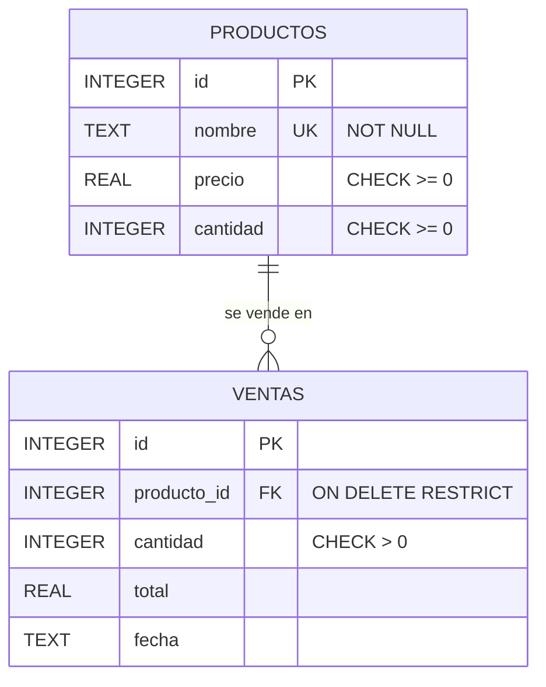
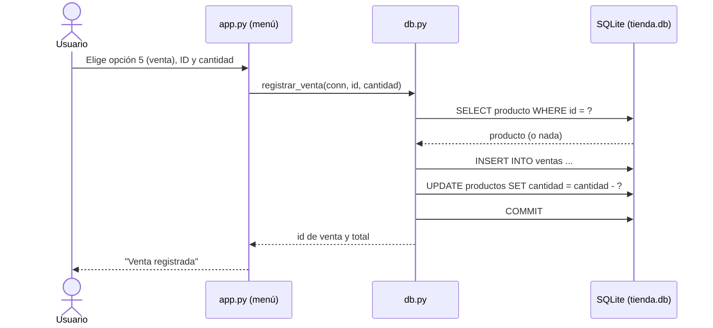
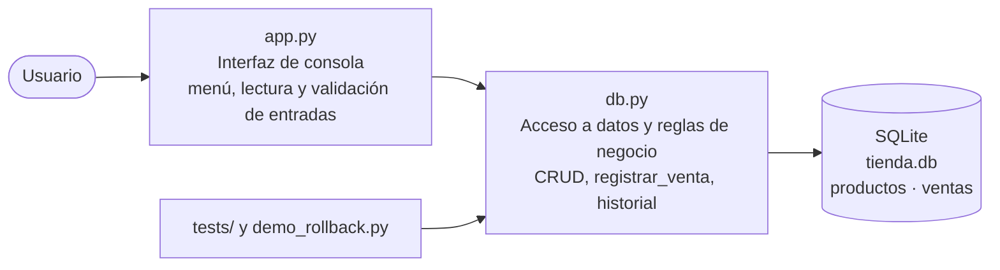
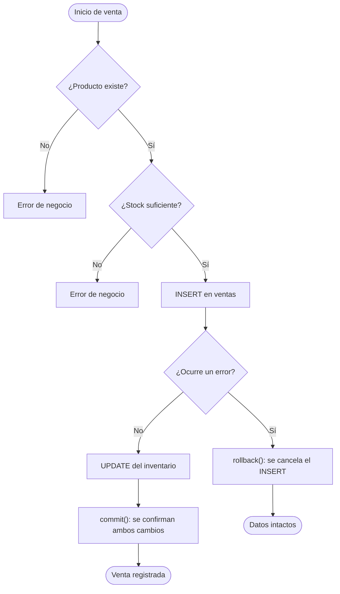

# Análisis y diseño

## 1. Entidades y atributos

| Entidad | Atributos | Notas |
|---|---|---|
| **Producto** | `id`, `nombre`, `precio`, `cantidad` | Es el inventario. `nombre` único; precio y cantidad ≥ 0. |
| **Venta** | `id`, `producto_id`, `cantidad`, `total`, `fecha` | Cada venta es de un solo producto. `producto_id` es clave foránea. |

Relación: **un producto puede tener muchas ventas** (1 : N); cada venta pertenece a un único producto.

## 2. Modelo de datos



Decisiones de diseño:
- **`ON DELETE RESTRICT`** + `PRAGMA foreign_keys = ON`: un producto con ventas no se puede borrar, así el
  historial nunca queda con referencias rotas. (SQLite no aplica claves foráneas salvo que se active el PRAGMA.)
- **`CHECK (cantidad >= 0)`** en productos: la propia base impide un stock negativo, aunque falle una validación en Python.
- `total` se guarda en la venta para conservar el precio vigente al momento de vender, aunque luego el precio cambie.

## 3. Diagrama de interacción: usuario – Python – SQLite



## 4. Arquitectura del software



Se separa en **capas**:
1. **Presentación (`app.py`)**: solo interactúa con el usuario (menú, `input`, `print`). No contiene SQL.
2. **Acceso a datos y negocio (`db.py`)**: todo el SQL (siempre parametrizado) y las reglas
   (existencia, stock, transacción). Lanza `ErrorNegocio` ante reglas incumplidas.
3. **Almacenamiento (SQLite)**: persistencia y restricciones de integridad (PK, FK, UNIQUE, CHECK).

Esta separación permite probar la lógica (`tests/`, `demo_rollback.py`) sin pasar por el menú, usando una base en memoria.

## 5. Operaciones al registrar una venta

1. Validar que la cantidad sea mayor que cero.
2. **Verificar que el producto exista** (`SELECT ... WHERE id = ?`).
3. **Comprobar que haya stock suficiente** (`cantidad_disponible >= cantidad_pedida`).
4. **Registrar la venta** (`INSERT INTO ventas`), calculando `total = precio × cantidad`.
5. **Descontar el inventario** (`UPDATE productos SET cantidad = cantidad - ?`).
6. **`commit()`**: confirma el INSERT y el UPDATE a la vez.
7. Si algo falla entre los pasos 4 y 6 → **`rollback()`**: se cancela todo, como si nada hubiera pasado.

## 6. La transacción y el rollback

El problema original de la tienda era registrar la venta sin actualizar el inventario. Una **transacción** agrupa
ambas operaciones en una unidad **atómica**: o se guardan las dos, o ninguna.



En el código (`db.registrar_venta`):

```python
try:
    conn.execute("INSERT INTO ventas ...", (...))      # paso 4
    if simular_error:
        raise ErrorSimulado("Fallo simulado ...")      # error controlado
    conn.execute("UPDATE productos SET cantidad = cantidad - ? ...", (...))  # paso 5
    conn.commit()                                      # paso 6
except Exception:
    conn.rollback()                                    # paso 7
    raise
```

**Cómo se demuestra** (`python demo_rollback.py` y opción 7 del menú): se pasa `simular_error=True`, que lanza
una excepción *después* del `INSERT` y *antes* del `UPDATE`. Se compara el estado antes y después:

| Momento | Stock | Ventas |
|---|---|---|
| Antes del error | 8 | 1 |
| Después del error + `rollback()` | 8 | 1 |

El stock y el número de ventas no cambian: el `INSERT` temporal fue revertido. Esto se verifica con `assert`
en `demo_rollback.py` y con el test `test_rollback_ante_error`.

## 7. Validaciones y manejo de errores

| Caso | Resultado |
|---|---|
| Producto inexistente | `ErrorNegocio`, no se escribe nada |
| Stock insuficiente | `ErrorNegocio`, no se escribe nada |
| Cantidad ≤ 0 | `ErrorNegocio` |
| Nombre de producto repetido | `ErrorNegocio` (UNIQUE) |
| Eliminar producto con ventas | `ErrorNegocio` (FK `RESTRICT`) |
| Fallo inesperado durante la venta | `rollback()` y se relanza la excepción |
